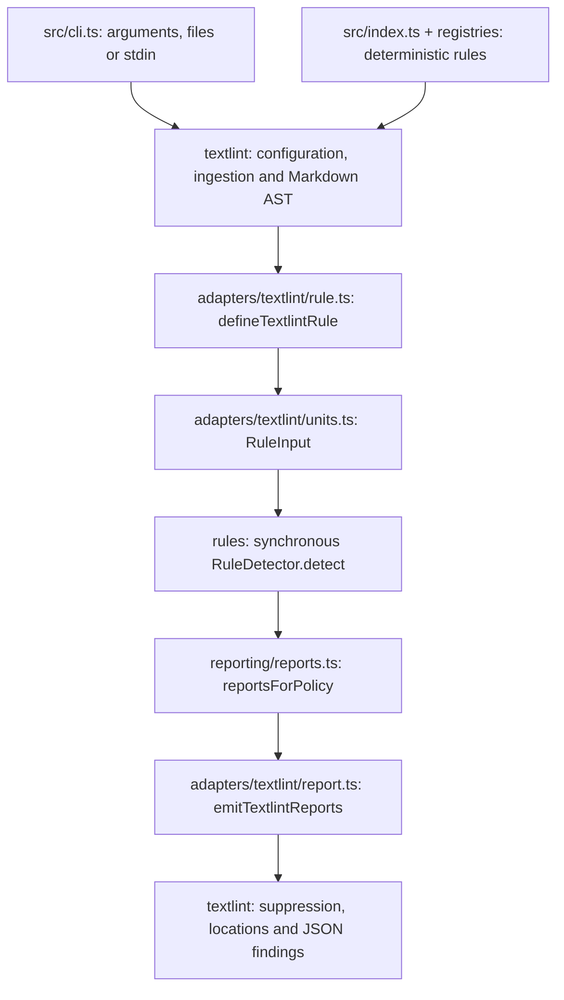
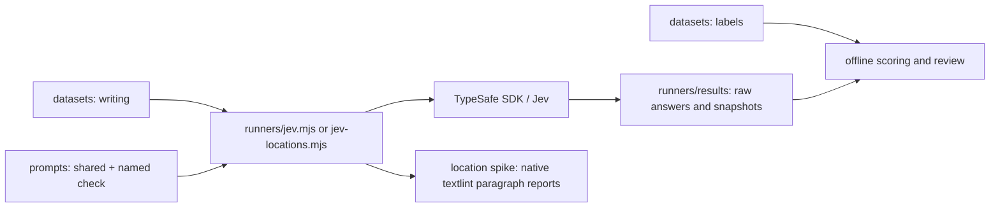
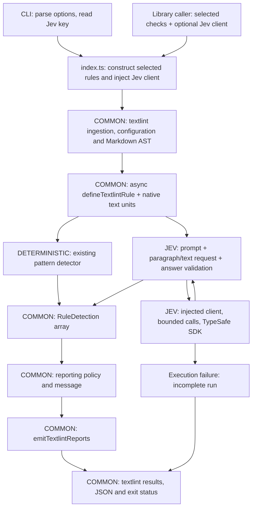
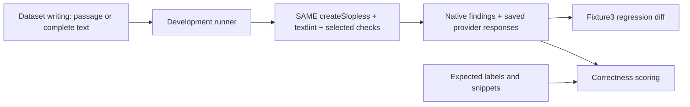

# Slopless V2 Module Connections

Proposed production structure connecting deterministic Slopless and Jev. The development runners evaluate these implementations; labels and scoring stay outside the shipped library.

## Current Production



- The existing shared boundary is `RuleInput -> RuleDetection[] -> RuleReport[]`. Rules identify occurrences; reporting applies density and severity.
- `TextUnit` retains the textlint node and source mapping. Reporting policies translate unit-text ranges to node-relative source ranges; the emitter passes them to textlint, which resolves original document positions.
- The CLI currently calls textlint's CLI implementation. Its configuration selects the deterministic exports from this package.

## Current Jev Experiments



- These runners already call Jev and score saved answers. The location spike also demonstrates original paragraph ranges through textlint.
- Production integration still needs shared execution, runtime prompt packaging and user credential handling. The runners currently own those experiment-specific operations.

## Proposed Production Flow



- Both backends implement the same detector interface. The textlint adapter awaits it; synchronous detectors continue to return an array directly.
- Jev owns prompt assembly, probability interpretation and provider response validation. Existing reporting owns density, severity and finding formatting.
- A Jev request receives writing and paragraph IDs. The adapter retains the node-to-ID mapping locally; SDK requests exclude AST nodes, labels and source-mapping functions.
- Reuse textlint's public `createLinter`, `lintFiles` and `lintText` APIs to inject constructed rule modules. Textlint continues resolving files, globs, ignore rules and Markdown; CLI option compatibility needs contract tests during this change.

## Module Ownership

```text
src/
  cli.ts                         existing; configure dependencies and call library
  index.ts                       existing; expose the shared linter factory
  rules/
    types.ts                     existing; extend detector to support async calls
    <family>/<check>.ts           existing/new; deterministic or Jev-backed definition
  registries/                    existing; compose rule definitions and selection
  adapters/
    textlint/
      rule.ts                    existing; await detector and apply reporting policy
      units.ts                   existing; prepare text and preserve native positions
      report.ts                  existing; emit reports on original nodes
    jev/
      detector.ts                proposed; prompt assembly and scores -> detections
      client.ts                  proposed; SDK, validation, concurrency and failures
  reporting/                     existing; shared policies and messages
prompts/<version>/               selected prompt sources; bundle only shipped versions
runners/                        development entry points and scoring
datasets/                       writing and independent correctness labels
```

The proposed Jev adapter files separate provider operations from rule meanings. They add one backend beneath the existing detector boundary.

## Small Interface Contracts

### Shared Detector

Reuse the existing `RuleInput`, `RuleId`, `RuleFamilyId`, `RuleDetection` and `RuleDefinition` records. Extend the family identifiers for the accepted V2 taxonomy; preserve existing public rule names during migration.

```ts
type DetectorOutput = readonly RuleDetection[];

interface RuleDetector<Options = unknown> {
  readonly id: RuleId;
  readonly family: RuleFamilyId;
  readonly detect: (
    input: RuleInput<Options>,
    signal: AbortSignal
  ) => DetectorOutput | Promise<DetectorOutput>;
}
```

- `RuleInput.units` contains the native text units selected for the check. Deterministic rules keep their existing sentence, paragraph or document selection.
- Paragraph Jev checks receive native paragraphs and any heading context required by their definition. Whole-text checks receive original document text plus native paragraph units together.
- For Jev, use `textUnitForNode` with `context.getSource(paragraph)`: raw paragraph text, local range `[0, raw.length]` and identity source mapping. Whole-text checks also receive a raw document unit for context; their detections reference paragraph units only.
- Keep existing deterministic unit selection, extracted text and source mapping unchanged. Jev raw units preserve the full-paragraph ranges demonstrated by the spike.
- The common adapter awaits `detect`, validates returned unit IDs and ranges, calls `reportsForPolicy`, then emits textlint reports. A rejected detector call makes the run incomplete.

### Shared Detection And Report

The records already exist. These are their essential fields; retain existing optional fields for current reporters.

```ts
type RuleDetection = {
  readonly ruleId: RuleId;
  readonly unitId: string;
  readonly range: SourceRange;
  readonly label: string;
  readonly evidence: string;
};

type RuleReport = {
  readonly ruleId: RuleId;
  readonly unitId: string;
  readonly range: SourceRange;
  readonly message: string;
  readonly detections: readonly RuleDetection[];
  readonly severity?: 1 | 2;
};
```

- A deterministic detection retains its precise matched range. A Jev detection covers the selected paragraph, using that unit's local range and original paragraph text.
- `evidence` is the existing internal field name. For a Jev paragraph finding it contains the paragraph text; the model has identified a paragraph-sized location.
- `reportsForPolicy` converts detection ranges from unit-text coordinates to node-relative source coordinates through `sourceRangeFor`. `emitTextlintReports` passes those report coordinates to textlint without converting them again.
- Textlint resolves final document positions from the node and padding. Each reported check keeps its own identity, even when two checks mark the same paragraph.
- A paragraph flag represents one affected paragraph. Existing occurrence-count density policies keep their deterministic occurrence inputs; model paragraph flags must not fabricate counts of words or repeated actions inside a paragraph.

### Jev Boundary

The Jev-backed rule supplies its selected prompt, model and cutoffs when constructing the detector. The injected client accepts a prepared request and returns validated probabilities; SDK types stay inside `adapters/jev/client.ts`.

```ts
type Paragraph = {
  readonly id: string;
  readonly text: string;
  readonly heading?: string;
};

type JevInput = {
  readonly model: string;
  readonly paragraphs: readonly Paragraph[];
  readonly instructions: string;
  readonly questions: Readonly<Record<string, {
    readonly instructions: string;
    readonly yes: string;
    readonly no: string;
  }>>;
} & (
  | { readonly input: "paragraph" }
  | { readonly input: "text"; readonly text: string }
);

type JevScores = Readonly<Record<string, number>>;

interface JevClient {
  judge(input: JevInput, signal: AbortSignal): Promise<JevScores>;
}
```

- Question instructions explicitly identify their paragraph or whole-text target. Question IDs correlate returned answers with local records; they carry no model-visible meaning by themselves.
- Paragraph checks batch independent paragraph questions with their raw text and any required heading. Full-text checks additionally supply the complete article; the whole-text context is mandatory in that input variant.
- The client enforces exact answer coverage, finite probabilities between zero and one, the pinned model, request limits and bounded network execution. Raw SDK receipts remain available to evaluation through its injected client implementation.
- For whole-text checks, one question judges the document and the remaining questions judge paragraph participation. The Jev detector applies the selected document and paragraph cutoffs, then returns common detections for selected paragraphs.
- Keep the accepted whole-text gate: a negative document answer yields no reported detections. A positive document answer without a selected paragraph produces an explicit incomplete-check failure.
- Preserve the experimental budget of sixteen questions per request: the first batch contains the document question and at most fifteen paragraph questions; later batches contain at most sixteen paragraph questions each. This budget is an execution setting rather than a claimed provider maximum.
- The single document answer from the first batch controls every paragraph result. Later batches contain no document question; all batches retain the complete original text and paragraph IDs.
- Require every planned batch and paragraph answer before completing the check. Preserve raw paragraph answers even when the document gate is negative; an interrupted batch makes the check incomplete. Count API calls and questions separately in measurements.

### Public Library And CLI

This factory is proposed. Keep the existing deterministic textlint exports while adding it.

```ts
interface SloplessOptions {
  readonly checks: readonly RuleId[];
  readonly jev?: JevClient;
}

interface Slopless {
  lintText(
    text: string, filePath: string, signal?: AbortSignal
  ): Promise<TextlintResult>;
  lintFiles(
    pathsOrGlobs: string[], signal?: AbortSignal
  ): Promise<TextlintResult[]>;
}

declare function createSlopless(options: SloplessOptions): Slopless;
```

- `TextlintResult` is textlint's existing public result type. The CLI formats those results as JSON; library callers receive the same records.
- Keep configuration, ignore-path and quiet/cache settings wired through textlint's existing options. The small interface above shows the check boundary; implementation must preserve the current CLI's supported behavior, including textlint's different ignore handling for files and stdin text.
- The CLI constructs the authenticated Jev client only when selected checks require it. A missing credential for an enabled model check is a configuration failure.
- Each lint call owns its cancellation signal. The shared client limits total in-flight requests across checks and files; CLI interruption aborts that call's work.
- Provider, validation and missing-location failures reject the run and produce a nonzero execution-failure exit. Already found issues cannot turn incomplete execution into a successful clean result.

## Development Uses The Same Runtime



- The runner selects independent labeled examples and calls the public runtime on each one. Complete texts stay intact; dataset passages can include several paragraphs.
- Multi-paragraph examples exercise production paragraph preparation. Compare those results against historical whole-passage scores before claiming that classifier quality carries over unchanged.
- It injects a recording Jev client for live measurement or a validated response-replay client for offline regression tests. Both return the same probability contract.
- Scoring reads expected labels after prediction. Fixture3 compares saved findings; the labels independently determine correctness.
- Retain the old experimental runners for the migration comparison, then remove superseded execution paths after the shared runtime reproduces the reviewed behavior. Git preserves their history.

## Known Location Defect

Detection and paragraph questions remain independent within a request. The accepted repeated-explanation development result has 97 located hits and six false positives under the whole-text gate; 92 correct detections match the expected paragraph sets exactly.

Keep this measured limitation in the [V2 shipping plan](2026-10-20-125402-v2-rule-taxonomy.md#v2-shipping-work). This diagram proposes module connections; production integration remains to be implemented.
