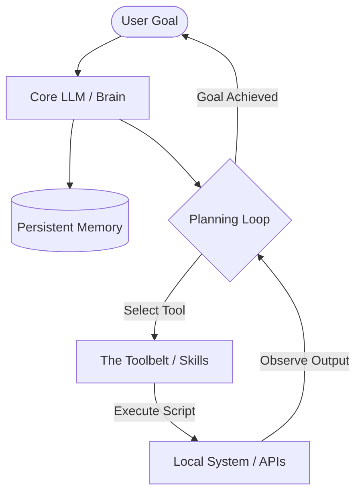

# Why 2026 Belongs to Agentic AI (And How to Build Your First Local Agent)


# Beyond the Chatbox: Why 2026 Belongs to Agentic AI (And How to Build Your First Local Agent)

For the past few years, the developer community has been flooded with conversational AI. We built chatbots, integrated LLM APIs into our side projects, and got used to typing prompt after prompt to copy-paste snippets of code. 

But as we navigate **2026**, the novelty of the simple "chatbox" has worn off. Developers are realizing that constantly copy-pasting text, running manual commands, and feeding error tracebacks back into a chat interface is a massive bottleneck. 

The industry is rapidly shifting to a much more powerful paradigm: **Agentic AI**.

If you are a software engineer, this is the most important architectural shift of the decade. In this comprehensive guide, we'll explore why agentic systems are taking over, deconstruct their core architecture, and build a fully functional, stateful local agent from scratch in Python.

---

## 📌 Table of Contents
1. [The Paradigm Shift: Chatbots vs. Agents](#the-paradigm-shift-chatbots-vs-agents)
2. [The Anatomy of a Stateful Local Agent](#the-anatomy-of-a-stateful-local-agent)
3. [The ReAct (Reasoning + Acting) Loop Explained](#the-react-reasoning--acting-loop-explained)
4. [Tutorial: Building Your First Local Agent in Python](#tutorial-building-your-first-local-agent-in-python)
5. [Critical Engineering Guidelines (Security & Boundaries)](#critical-engineering-guidelines-security--boundaries)
6. [Conclusion: The Future of Developer Workflows](#conclusion-the-future-of-developer-workflows)

---

## The Paradigm Shift: Chatbots vs. Agents

To understand why this shift is revolutionary, let's compare how we interact with these two architectures. 

A traditional **chatbot** is a *passive advisor*. It sits in a tab, waiting for you to send a message. You give it an input, it uses its training data to generate a text output, and the session ends. If the code it generates has a bug, you have to copy the error, paste it back, and ask for a fix. You are the glue holding the execution loop together.

An **AI Agent**, on the other hand, is an *active collaborator*. You give it a high-level goal (e.g., *"Analyze our database schema, write a migration script to add a 'status' column, run the tests, and save the result as a draft on GitHub"*). The agent doesn't just tell you how to do it—it plans the steps, selects the appropriate tools, executes the scripts, inspects the error logs if things fail, and iterates until the goal is fully achieved.

Here is a quick comparison:

| Feature | Traditional Chatbot | Stateful AI Agent |
| :--- | :--- | :--- |
| **Trigger** | Reacts strictly to user prompts | Executes multi-step plans autonomously |
| **Capabilities** | Text generation and advice | Runs bash commands, edits files, calls APIs |
| **Memory** | Volatile, session-based | Persistent (logs, vector stores, markdown state) |
| **Tool Integration**| None | Dynamic tool/skill selection based on intent |
| **Execution Role** | The developer executes | The agent executes; developer reviews |

---

## The Anatomy of a Stateful Local Agent

While enterprise-level multi-agent systems are gaining traction, the most exciting and custom developer setups in 2026 are **local-first**. By running your agent locally, you maintain absolute control over your files, system resources, and API keys.

A modern local agent consists of four core pillars:



### 1. The Brain (The Core LLM)
The LLM acts as the central reasoning engine. It parses user intent, breaks complex goals down into sub-tasks, and decides which tool to call based on the current system state.

### 2. The Context (Stateful Memory)
Unlike stateless API calls, a true agent relies on persistent storage to maintain context across sessions. This includes:
*   **Short-term memory:** The execution logs of the current loop.
*   **Long-term memory:** Persisted files (like Markdown logs, YAML configurations, or local vector indexes) that store user preferences, project notes, and previous outcomes.

### 3. The Planner (The Execution Loop)
The planner runs the execution loop. It dictates how the agent thinks, acts, and refines its behavior based on tool outputs.

### 4. The Toolbelt (Skills)
An agent is only as powerful as the tools it can use. Tools are small, modular scripts (written in Python, Bash, or Node.js) that allow the agent to interact with the outside world—such as writing files, calling a third-party API, or querying database tables.

---

## The ReAct (Reasoning + Acting) Loop Explained

Most modern agents use a paradigm called **ReAct** (Reasoning and Acting). Instead of predicting the entire answer at once, the agent executes a structured cycle:

1.  **Thought:** The agent reasons about the current state. (*"I need to fetch the latest analytics. I should use the stats tool."*)
2.  **Action:** The agent executes a specific tool with defined arguments.
3.  **Observation:** The agent receives and inspects the tool's output. (*"The tool returned a 401 Unauthorized error."*)
4.  **Refine:** The agent updates its thought process based on the observation. (*"The API key is missing. I should check the .env file first."*)

By repeating this cycle, the agent handles unexpected errors and edge cases autonomously, mimicking a human developer's trial-and-error process.

---

## Tutorial: Building Your First Local Agent in Python

Let's build a simple, clean, and fully operational local agent in Python. This agent will read a user goal, autonomously plan its actions, and execute custom Python scripts to interact with your system.

### Step 1: Setting Up the Tools
First, let's create a couple of simple tools in our workspace. We'll build a file writer tool and a web search simulator tool.

Save this as `tools.py`:

```python
import os
import json

def write_file(filename: str, content: str) -> str:
    """Writes content to a file safely."""
    try:
        # Prevent path traversal for safety
        base_dir = os.path.abspath("./workspace")
        os.makedirs(base_dir, exist_ok=True)
        target_path = os.path.abspath(os.path.join(base_dir, filename))
        
        if not target_path.startswith(base_dir):
            return "Error: Access denied (path traversal blocked)."
            
        with open(target_path, "w", encoding="utf-8") as f:
            f.write(content)
        return f"Success: Wrote to {filename} successfully."
    except Exception as e:
        return f"Error writing file: {str(e)}"

def simulate_search(query: str) -> str:
    """Simulates a secure web search returning structured data."""
    # A real tool would use requests to call Google, Bing, or Tavily API
    data = {
        "agents": "Agentic AI is the top tech trend of 2026, shifting focus from passive chat to active loops.",
        "quantum": "US government announces a $2B quantum computing investment across nine companies in mid-2026."
    }
    for key, val in data.items():
        if key in query.lower():
            return json.dumps({"query": query, "result": val})
    return json.dumps({"query": query, "result": "No relevant news found."})
```

### Step 2: The Agent Orchestrator
Now, let's build the central orchestrator that runs the ReAct loop. We'll use a simple JSON-based tool selection prompt.

Save this as `agent.py`:

```python
import json
from openai import OpenAI  # Or use your preferred LLM provider / local model
from tools import write_file, simulate_search

# Initialize your client (e.g., local model running on Ollama, or OpenAI/OpenRouter)
client = OpenAI(api_key="your_api_key_here")

SYSTEM_PROMPT = """
You are an autonomous local AI agent. You solve user goals by planning and executing tools.
You run in a loop of Thought -> Action -> Observation -> Thought.

You have access to the following tools:
1. write_file(filename, content) - Writes markdown or text content to a local file.
2. simulate_search(query) - Searches for live information.

To call a tool, respond with a JSON object in this format:
{
    "thought": "Your reasoning here",
    "tool": "tool_name",
    "params": {
        "param1": "value"
    }
}

Once you have fully achieved the goal, respond with:
{
    "thought": "I have completed the task.",
    "final_answer": "Summary of what was achieved"
}
"""

def run_agent(goal: str):
    messages = [
        {"role": "system", "content": SYSTEM_PROMPT},
        {"role": "user", "content": f"Your Goal: {goal}"}
    ]
    
    print(f"🚀 Starting Agent Loop to achieve: '{goal}'\n")
    
    for step in range(5):  # Limit loop to 5 iterations to prevent infinite runs
        print(f"--- Step {step + 1} ---")
        
        # Get decision from LLM
        response = client.chat.completions.create(
            model="gpt-4o-mini",  # Or your chosen local/API model
            messages=messages,
            response_format={"type": "json_object"}
        )
        
        decision = json.loads(response.choices[0].message.content)
        thought = decision.get("thought")
        tool = decision.get("tool")
        params = decision.get("params", {})
        final_answer = decision.get("final_answer")
        
        print(f"🤔 Thought: {thought}")
        
        if final_answer:
            print(f"\n🎉 Goal Achieved! {final_answer}")
            break
            
        print(f"🛠️ Action: Calling {tool} with {params}")
        
        # Execute tool
        if tool == "write_file":
            observation = write_file(params.get("filename"), params.get("content"))
        elif tool == "simulate_search":
            observation = simulate_search(params.get("query"))
        else:
            observation = f"Error: Tool {tool} is not defined."
            
        print(f"👁️ Observation: {observation}\n")
        
        # Feed observation back to the model's history
        messages.append({"role": "assistant", "content": json.dumps(decision)})
        messages.append({"role": "user", "content": f"Observation from tool: {observation}"})

if __name__ == "__main__":
    goal = "Search for quantum computing news in 2026 and write a summary to a file named quantum_report.md"
    run_agent(goal)
```

---

## Critical Engineering Guidelines (Security & Boundaries)

Building an autonomous agent is incredibly rewarding, but developers must adhere to strict safety practices to keep their environments secure:

### 1. The Principle of Least Privilege
Never grant your agent root permissions or unchecked access to your entire filesystem. Restrict file tools to a specific subdirectory (as shown in the `write_file` tool above) using path validation to block path traversal.

### 2. Make Deletion Physically Impossible
If you don't want your agent to accidentally delete your code, **do not build deletion tools**. By omitting `rm`, `delete-post`, or SQL `DROP` actions from the script library, you create an unbreakable physical boundary. Even if the agent is prompted to delete something, it has no tools capable of doing so.

### 3. Always Default to Drafts (The Human-in-the-Loop Model)
When building integrations for publishing platforms (like Dev.to, GitHub, or Medium), always configure your write tools to upload as **drafts (`published: false`)** by default. This ensures you can inspect the agent's work, formatting, and quality before anything goes live to your audience.

---

## Conclusion: The Future of Developer Workflows

The transition from passive chatbots to active, stateful agents is reshaping how software is built. Instead of treating AI as a search engine, developers in 2026 are treating it as a digital junior engineer—equipping it with custom tools, keeping it sandboxed, and reviewing its outputs before deployment.

By shifting our focus from writing better conversational prompts to building modular, secure, and robust *tools* for our agents to use, we unlock a completely new scale of productivity.

*What are you building in the agentic AI space this year? Are you running custom local agent loops, or integrating third-party agent frameworks into your production apps? Let's discuss in the comments below!*

